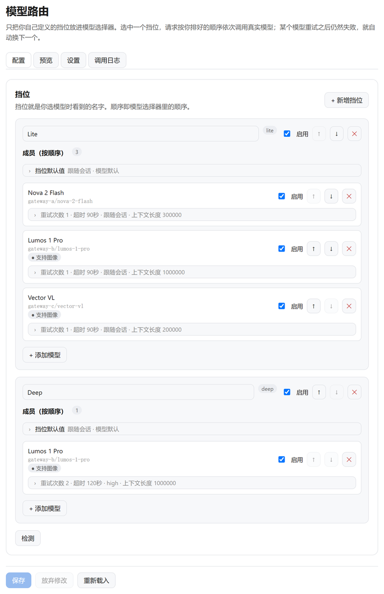
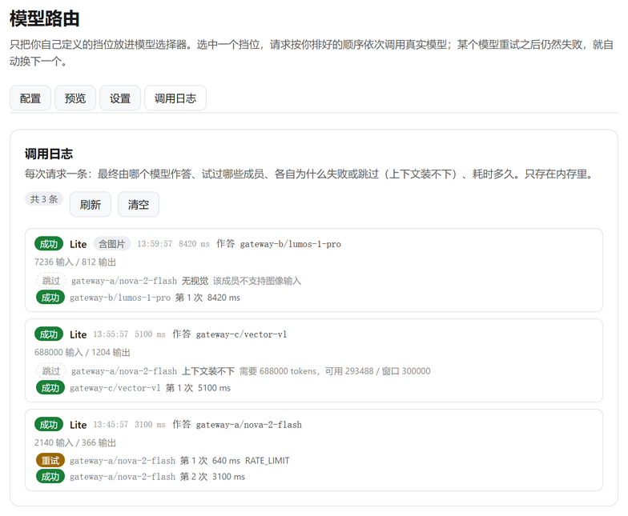

# Echelon

> **Tier-based model routing** for [DeepSeek Harness](https://github.com/deepseek-ai/deepseek-harness). Collapse a dozen models into a few names you choose; behind each name is an ordered chain of real models — called in order, retried, failed over automatically.

[](https://github.com/Abnerluo123/dsh-echelon/releases)
[](LICENSE)

[中文](README.md)

```sh
dsh plugin --profile desktop add dsh-echelon
```



## What it solves

The DSH model picker lists **every** model you can reach. With a few providers that becomes a dozen entries of differing names and capabilities, so each new conversation starts with "which one this time?".

Echelon replaces that with naming: define a few tiers (`daily`, `deep`, `free`…) and the picker shows only those names.

## Three things that matter

### Models of different capability can back each other up

This is the least obvious part. Mixing unequal models in one chain hits three obstacles, and **each one turns "automatic failover" into silent degradation**:

| Obstacle | What Echelon does |
|---|---|
| **Reasoning levels named differently** (`medium` / `max` / not declared) | One vocabulary `off / low / middle / high / xhigh`, translated per member at dispatch; a level that cannot land falls back to the member's own default |
| **Different context windows** (1M beside 300K) | Advertises the **largest** window, then picks a member that fits this request |
| **Different vision support** (multimodal beside text-only) | An image request skips members that cannot see |

So the strong and the cheap model can share one chain: small requests go cheap, large ones land on the big window, image requests land on the one that can see. **You never have to know which happened.**



> One request in this log triggered all three: an image skipped the vision-less member, a large context skipped the small-window member, then a rate-limited call succeeded on retry.

### A cleaner picker

Hide the real models, leave your tiers. The default is "show everything" — hiding is something you choose after a tier works. **Hiding lifts automatically when no tier can dispatch**, so the menu can never become an empty list that locks you out of settings.

### Compatible with existing plugins

A member can be another plugin's route, because they are all just `provider/model` strings: `dsh-our-free-model` lanes, `dsh-model-fusion`'s `auto`, anything that registers a provider.

No DSH patching. Echelon registers one provider route and wraps one public read-only method to implement hiding.

## Quick start

```sh
dsh plugin --profile desktop add dsh-echelon
```

Requires **DSH ≥ 0.2.0-rc.1** and **Node ≥ 22.14.0**. **Restart `dsh`** afterwards and reload the page.

1. **Configure → New tier**, give it a name.
2. **Add models** in priority order — that order is the failover order.
3. Once it answers, switch **Settings → What the model picker shows** to "Tiers only".

> A fresh install shows everything, so **none of your models disappear**.

## Advanced

- **Per-member controls**: retries, timeout, reasoning effort, context window, max output, vision (force it for a model that supports images but does not declare them).
- **Timeout measures progress, not traffic**: a lane that only sends keepalives, empty deltas or usage rows is still dead and still fails over; reasoning counts as progress. Default 180s, switchable off.
- **Default level for new chats**: follow the model, or pin one of the five levels.
- **Reasoning mapping switch**: on means one five-level vocabulary in the picker, translated onto each member at dispatch (nearest published level, or the model's default when it publishes none); off shows each model's own levels and forwards them as written. The per-member control in the editor always offers only that model's own levels — it pins one member, so it must not name a level that member cannot honour.
- **Selection strategy**: chain order (default) or most free space.
- **Image routing**: pick a member that can see; only the current turn's image counts (an older image stops affecting selection).
- **Request log**: each turn shows **tier → real model**, how the level was translated (`xhigh → max`, or not sent at all), every member tried, why each was skipped, duration and tokens. In memory, switchable off.
- **Context shorthand**: `128k` and `1m` instead of counting zeros; `k`=1024, `m`=1048576.
- **Saves apply immediately**: no restart, no page reload.
- **Settings file**: `$DSH_HOME/model-router/settings.json`, hand-editable (and `"128k"` is accepted there too); writes go through a temp file and a rename.

### How the timeout is decided

The panel shows one line; the detail lives here.

The watchdog measures **progress**, not traffic. The difference matters: many gateways keep a stalled stream warm with heartbeats, empty deltas or usage-only rows, and a rule of "any data arrived" lets such an attempt run forever while the screen stays blank.

Counts as progress: a `text-delta` / `reasoning-delta` with non-whitespace text (one character is enough), a tool call with a name or non-empty arguments, a block boundary, the finish chunk. Does **not** count: empty strings, whitespace-only deltas, usage-only rows, unknown heartbeat types.

One budget covers all three places a member can stall:

| Stage | Before | Now |
|---|---|---|
| `resolveModelInfo` | no deadline (a hang left the log empty) | 8s, then degrades to "capabilities unknown" |
| `prepareCall` | no deadline | the member's own budget |
| streaming | only when nothing at all arrived | same budget, judged by progress |

On timeout the member's request is **cancelled**, and cleanup is bounded to one second — otherwise the cleanup itself blocks on the same read, which is how an 8-second budget produced a 277-second attempt.

On false positives: a model that thinks keeps emitting reasoning deltas and is never cut off, and a model waiting on a local command has already finished its call with a tool-call block — so a ten-minute local task is unaffected.

### How the inputs behave

- Nothing is validated or corrected **while typing**: you can clear "90" to "9", to empty, and retype.
- Normalisation happens once, on **blur or Enter**: below the minimum becomes the minimum, above the maximum becomes the maximum, empty means "unset".
- No stepper arrows; arrow keys and the wheel cannot change a value.

## How it differs from other tools

Echelon is a **DSH plugin**, not a standalone model gateway — that difference decides what it is good for:

| | Echelon | LiteLLM / One-API / New-API / OpenRouter |
|---|---|---|
| Form | plugin inside DSH | standalone service exposing an OpenAI-compatible endpoint |
| Reach | only inside DSH | any OpenAI-compatible client (Cursor, Cline, Cherry Studio, Chatbox…) |
| Setup | install into DSH | run a service, configure ports and keys |
| Routes by | tier + context size + image + effort level | usually model name, weights, quota, rate limits |
| Answers | "which model should DSH use" | "one entry point for every client" |

So if you want a single OpenAI-compatible entry point for Cursor, Cline, Cherry Studio or Chatbox, **LiteLLM or One-API is the right tool** — Echelon does not expose an external endpoint and cannot do that.

If you want to stop memorising a dozen model names **inside DSH**, with automatic failover that also respects context size and images, that is what Echelon is for. The two can coexist: register LiteLLM as a DSH provider and let Echelon put it in the same tier as your free lanes.

## Keywords

**English**: model router, model cascading, sequential fallback, automatic failover, multi-provider LLM, provider routing, rate-limit handling (HTTP 429), request retry, reasoning-effort mapping, context-window routing, vision / multimodal routing, DeepSeek Harness plugin

**中文**：模型路由 / 模型聚合 / 挡位 / 按序降级 / 接口兜底 / 失败自动切换 / 渠道自动切换 / 防限流 / 429 处理 / 免费模型聚合 / 多供应商 LLM / 思考档位映射 / 上下文窗口路由 / 视觉能力路由

## Other install methods

| Method | Command |
|---|---|
| **npm** (recommended) | `dsh plugin --profile desktop add dsh-echelon` |
| Pin a version | append `#v1.3.0` |
| GitHub source | `dsh plugin --profile desktop add github:Abnerluo123/dsh-echelon` |
| Plugin market | Plugins → Market, search `Echelon` |

Replace `desktop` with your profile name (`dsh profile list`).

**Verify**: `dsh plugin --profile desktop list` should contain `dsh-echelon`, and **Echelon** appears in settings.

**Uninstall**: `dsh plugin --profile desktop remove dsh-echelon`. Settings stay in `settings.json`; delete that file to remove them completely.

## Known limitations

- **Hiding wraps `llm.listModels`**: DSH has no catalog-filter hook, so code that reads an adapter directly is not filtered.
- **The request log is memory only**: cleared on restart; a debugging view, not an audit trail.
- **An undeclared vision capability is unknown**: still a candidate for image requests, but never preferred.
- **`ABORTED` and `CONTEXT_WINDOW_EXCEEDED` never fail over**: you cancelled the first; the second would not fit elsewhere either.
- **The internal route id remains `model-router`**: the rebrand did not change it, so saved sessions and settings keep working.

## Development

```sh
node --test test/               # 211 tests, no network needed
node scripts/verify-profile.mjs # can the current profile load this plugin?
```

`test/integration.test.js` uses the **real** `LlmRuntime`, when the DSH app packages are present locally, to exercise registration, dispatch, hiding and failover.

| File | Responsibility |
|---|---|
| `index.js` | Host entry: register the route, catalog filter, settings API |
| `src/adapter.js` | Chain dispatch, streaming, retries, failover, log writes |
| `src/config.js` | Normalization, chain expansion, context and modality filters |
| `src/effort.js` | Effort vocabulary and per-member translation |
| `src/tokens.js` | Request size estimation and image detection |
| `src/catalog.js` | Catalog filter (hiding) and the unfiltered read |
| `client.js` | Settings page and request-log view |

## License

MIT
