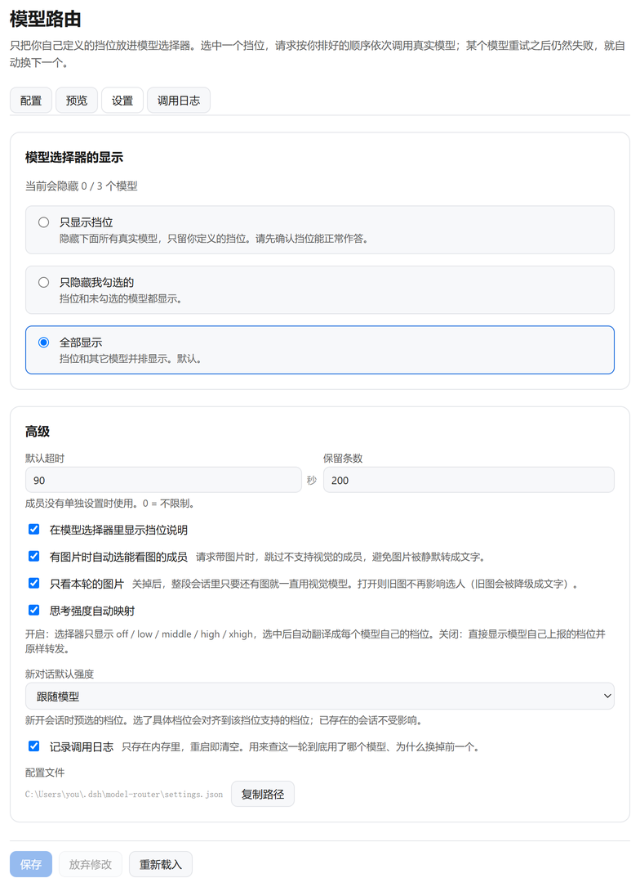

# dsh-model-router

> 把模型选择器换成一小组你自己命名的**挡位**。每个挡位背后是一条有序的真实模型链：按你排的顺序调用，失败重试，不行就换下一个。

[](https://github.com/Abnerluo123/dsh-model-router/releases)
[](LICENSE)

DeepSeek Harness 插件 · [English](README.en.md)

---

## 它解决什么问题

DeepSeek Harness 的模型选择器会列出**每一个**能用的模型。接了几个供应商之后，这个列表很快就变成十几个名字各异、能力不同的条目 —— 每次开新对话都要重新判断"这次该用哪个"。

模型路由把这一步换成命名：你在「配置」里定义几个挡位（`日常`、`深度`、`免费`…），选择器里就只剩这几个名字。选中哪个，插件按你排的顺序去调用真实模型。


## 核心亮点

### 1. 能力不同的模型可以互相当备用

这是插件最不显然的部分。一个挡位里放能力不同的模型时，会遇到三个具体障碍 —— **每一个都会让"自动换模型"变成"悄悄降级"**：

| 障碍 | 插件怎么做 |
|---|---|
| **思考档位命名不同**（`medium` / `max` / 什么都不声明） | 统一成 `off / low / middle / high / xhigh` 五档，派发时按成员翻译成它自己的名字 |
| **上下文窗口不同**（1M 与 300K 混在一条链里） | 挡位上报**最大**窗口，再按本次请求大小挑一个装得下的成员 |
| **视觉能力不同**（多模态与纯文本混在一条链里） | 请求带图片时跳过看不了图的成员，交给能看的 |

于是"能力强的"和"便宜的"可以共处一条链：小请求走便宜的，大请求自动落到大窗口那个，带图请求自动落到能看图那个。**你不需要知道背后发生了什么。**


> 这张日志里同时出现了三种判断：带图请求跳过了无视觉成员、大上下文请求跳过了小窗口成员、限流后重试成功。

### 2. 系统模型选择器变干净

隐藏真实模型，只留挡位。三种模式：只显示挡位、只隐藏勾选的、全部显示（**默认**）。

安全设计：**挡位里没有能派发的成员时，隐藏会自动放开** —— 菜单永远不会变成一个进不去设置页的空列表。

### 3. 兼容现有插件

成员可以是**其它插件的路由**，它们都只是 `供应商/模型` 字符串：

- `dsh-our-free-model` 的免费车道与组合
- `dsh-model-fusion` 的 `auto`
- 任何自己注册了 provider 的插件

不修改 DSH 本体，不 patch 任何东西 —— 只注册自己的 provider 路由，并包装一个公开只读方法来实现隐藏。

## 快速上手

### 安装

```sh
dsh plugin --profile desktop add github:Abnerluo123/dsh-model-router
```

需要 **DSH ≥ 0.2.0-rc.1**、**Node ≥ 22.14.0**。装完**重启 `dsh`**（热重载不够），刷新页面，设置里出现 **模型路由**。

### 三步配置

1. **配置 → 新增挡位**，起个名字（例如 `日常`）。
2. **添加模型**，按想要的优先级排列 —— 顺序就是失败时的尝试顺序。
3. 确认能正常对话后，再到 **设置 → 模型选择器的显示** 切成「只显示挡位」。

> 第一次安装时显示模式是「全部显示」，**你的模型列表一个都不会少**。隐藏是你确认挡位可用之后主动做的选择。

## 高级功能

### 每个成员可以单独调

点成员下方的折叠行展开：

| 设置 | 说明 |
|---|---|
| **重试次数** | 这个成员失败后再试几次才换下一个（`0` = 不重试） |
| **超时** | 这么久没收到数据就换下一个（`0` = 不限） |
| **思考强度** | 留空跟随会话；选了就固定用这一档 |
| **上下文长度 / 最大输出** | 留空用模型上报值；填了覆盖它 |
| **视觉能力** | 模型能看图但没上报时，手动标为「强制支持图像」 |



### 新对话默认强度

**设置 → 高级 → 新对话默认强度**：留空跟随模型自己的默认档位；也可以固定成 `off / low / middle / high / xhigh` 之一。

已存在的会话不受影响 —— 它们保留各自选过的档位。

### 思考强度映射开关

| 状态 | 选择器显示 | 派发行为 |
|---|---|---|
| **开（默认）** | 五档统一词汇 `off / low / middle / high / xhigh` | 逐成员翻译成模型自己的档位名 |
| 关 | 模型自己上报的档位 | 原样转发，不翻译 |

开启时你只在五个档位里选，各模型都能用；关闭时看到的是模型真实档位，适合排查问题。

### 选人策略

挡位级设置，决定「多个成员都装得下时选谁」：

| 策略 | 行为 |
|---|---|
| **按顺序**（默认） | 链上第一个装得下的，最可预测 |
| **优先剩余空间** | 选剩余窗口最大的，避免长对话被挤到刚好够用的模型上 |

### 图片路由

- **有图片时自动选能看图的成员**（默认开）—— 否则图片会被 DSH 静默降级成文字；
- **只看本轮的图片**（默认开）—— 旧图不再影响后续轮次的选人。

如果挡位里**没有**能看图的成员，请求仍会发出，但日志会明确记一条「无视觉」，而不是让你误以为模型没看懂图。

### 调用日志

每次请求一条：最终谁作答、试过哪些成员、各自为什么失败或被跳过、耗时与 token 用量。

日志**只存在内存**，重启即清空，可以关闭。跳过原因带具体数字，例如「需要 688000 tokens，可用 293488 / 窗口 300000」。

### 设置文件

`$DSH_HOME/model-router/settings.json`（Windows 为 `C:\Users\<你>\.dsh\model-router\settings.json`）。可以手改，下一次请求生效。字段缺失、类型不对、数值越界都会被规范化；写入采用「先写临时文件再重命名」，中途失败不会留下半份配置。

## 其它安装方式

| 方式 | 命令 / 位置 |
|---|---|
| **GitHub（推荐，现在就能用）** | `dsh plugin --profile desktop add github:Abnerluo123/dsh-model-router` |
| npm 包名（发布到 npm 后可用） | `dsh plugin --profile desktop add @abnerluo123/dsh-model-router` |
| 指定版本 | 在任一来源后加 `#v1.2.2` |
| 插件市场 | 插件 → 插件市场，搜索 `dsh-model-router`（走 npm 包） |
| 本地源码 | `git clone` 后 `dsh plugin --profile desktop add /绝对路径` |

`desktop` 换成你的 profile 名（`dsh profile list` 可列出）。

**验证安装**：确认 profile 的 manifest 登记了插件

```sh
cd "$DSH_HOME/profiles/desktop"
node -e "console.log(require('./package.json').dsh.profile.bundles.includes('dsh-model-router'))"
```

输出 `true` 即已登记。注意 `dsh plugin list` 只列出 npm 依赖 —— 从本地路径或 `file:` 装的插件可能不显示，那是 pnpm 的行为，不代表没装上。

**卸载**：`dsh plugin --profile desktop remove dsh-model-router`。配置保留在 `settings.json`，需要彻底清理时手动删除。

## 已知限制

- **隐藏依赖包装 `llm.listModels`**。DSH 没有目录过滤钩子，所以插件包装了服务实例上这一个公开只读方法。绕过它直接读适配器的代码不会被过滤。
- **调用日志只在内存里**。重启即清空；它是排障视图，不是审计记录。
- **未声明视觉能力的模型按"未知"处理**。它仍是图像请求的候选（DSH 会把图片原样传给它），但不会优先被选中。确实支持视觉却没上报的模型，用成员里的「视觉能力」手动指认。
- **`ABORTED` 与 `CONTEXT_WINDOW_EXCEEDED` 不降级**。前者是你自己取消的，后者换个模型也装不下这段上下文。

## 开发

```sh
node --test test/               # 全部测试
node scripts/verify-profile.mjs # 检查当前 profile 能否加载本插件
```

测试不需要网络，也不需要 DSH 运行时。`test/integration.test.js` 在本机存在 DSH 应用包时，会用**真实的** `LlmRuntime` 跑注册、派发、隐藏与降级。

| 文件 | 职责 |
|---|---|
| `index.js` | Host 入口：注册路由、挂载目录过滤与设置 API |
| `src/adapter.js` | 适配器：按链派发、流式转发、重试、降级、写日志 |
| `src/config.js` | 纯配置逻辑：规范化、链展开、上下文与模态筛选 |
| `src/effort.js` | 思考档位词汇表与逐成员翻译 |
| `src/tokens.js` | 请求大小估算与图片识别 |
| `src/catalog.js` | 目录过滤（隐藏）与未过滤读取 |
| `src/http.js` | 设置 / 日志 API 与同源检查 |
| `src/store.js` | 原子写入 + 按 mtime 失效的缓存 |
| `client.js` | 浏览器半身：设置页与调用日志页 |

## License

MIT
